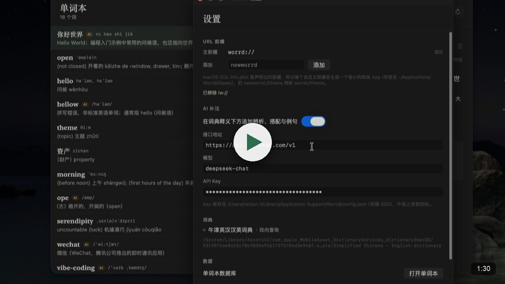
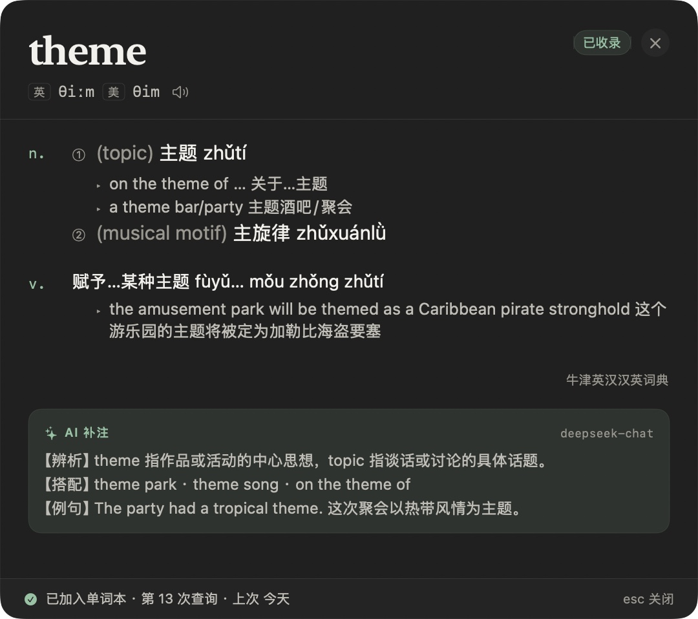
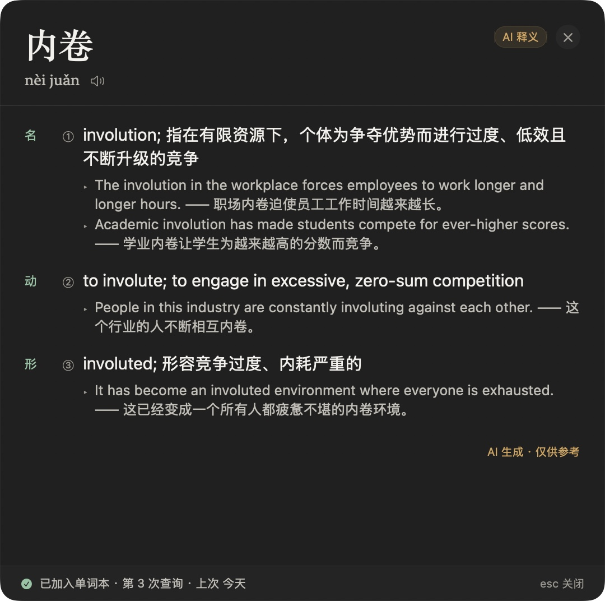
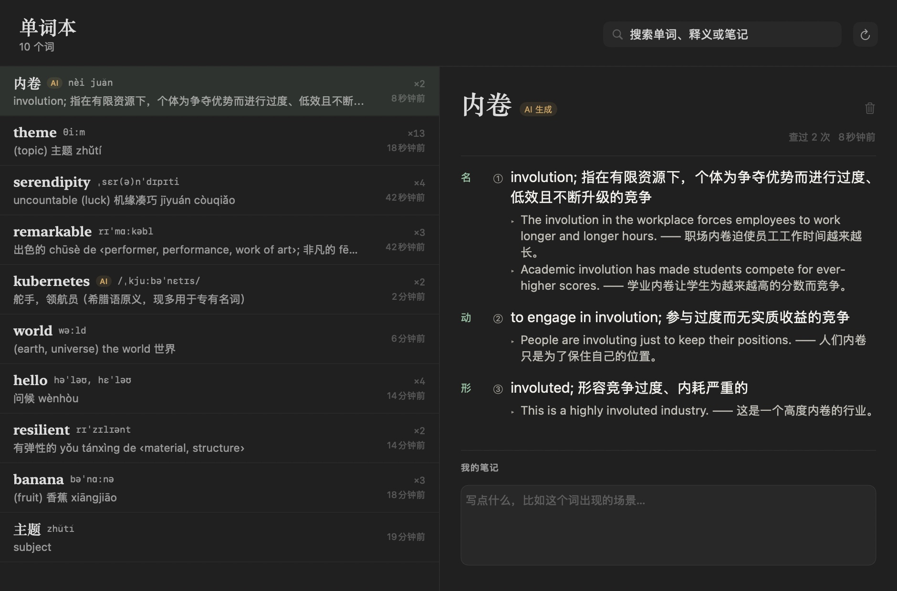
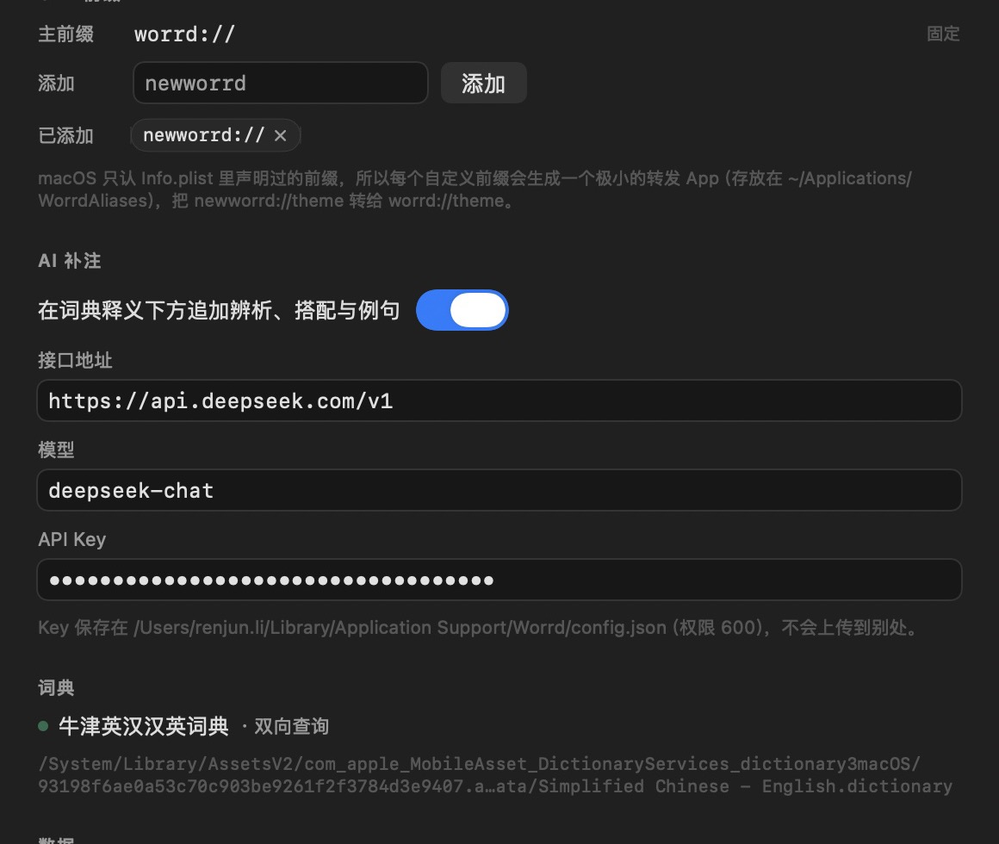

<p align="center">
  
</p>

<p align="center">
  
  
  
  
  <a href="https://www.bilibili.com/video/BV1GLy7zwEyu/"></a>
</p>

<p align="center">
  <sub>Look up words from Spotlight. Build a wordbook without trying.</sub>
</p>

---

## 这是什么

读英文文章时，遇到生词的标准流程是：复制 → 切到词典 App → 粘贴 → 看完 → 切回来 → 想记住的话再手动记一条。

Worrd 把这段压缩成一次回车：

```
⌘Space  →  worrd://theme  →  回车
```

释义浮窗立刻出现，同时这个词已经被记进本地单词本。查得越多，生词库越完整。

## 演示视频

<p align="center">
  <a href="https://www.bilibili.com/video/BV1GLy7zwEyu/">
    
  </a>
</p>

<p align="center"><sub>▶ 在 Bilibili 观看 90 秒演示：Spotlight 取词、AI 兜底、单词本。</sub></p>

## 功能

| 功能 | 说明 |
| --- | --- |
| **Spotlight 即查** | 不装第三方启动器、不占全局快捷键，`⌘Space` 输入 `worrd://单词` 回车即可 |
| **中英双向** | 英文查中文，中文查英文（`worrd://主题`） |
| **离线牛津词典** | 直接调用系统自带的《牛津英汉汉英词典》，毫秒级，断网也能用 |
| **自动入库** | 每次查询自动记录，累计查询次数和最近查询时间，不需要手动收藏 |
| **AI 补注** | 在词典释义下方追加「辨析 / 搭配 / 例句」，异步加载，不阻塞首屏 |
| **AI 兜底** | 牛津没有收录的词，自动改走 AI 生成同结构释义，并明确标注「AI 生成 · 仅供参考」 |
| **单词本** | 搜索、详情、可编辑笔记、删除；AI 词条带 `AI` 标签 |
| **自定义前缀** | 除了 `worrd://`，还能加 `newworrd://`、`lw://` 等任意前缀 |
| **朗读与明暗主题** | 单词可朗读；界面跟随系统浅色 / 深色 |

## 截图

### 查词浮窗

<p align="center">
  
</p>

<p align="center"><sub>牛津释义打底，AI 补注在下方异步出现，底部显示第几次查询。</sub></p>

### 词典没有的词，AI 兜底

<p align="center">
  
</p>

<p align="center"><sub>牛津未收录时，AI 生成同结构的词条，并标注来源，不冒充词典。</sub></p>

### 单词本

<p align="center">
  
</p>

<p align="center"><sub>左侧列表、右侧详情；笔记即时保存，AI 词条有标记。</sub></p>

### 设置

<p align="center">
  
</p>

<p align="center"><sub>AI Key、自定义 URL 前缀、词典状态、数据位置，都在这一页。</sub></p>

## 安装

目前只提供源码构建（还没做签名和公证的分发包）。

**环境要求**：macOS 14+、Xcode 或 Command Line Tools、[xcodegen](https://github.com/yonaskolb/XcodeGen)。

```bash
brew install xcodegen

git clone https://github.com/LieonShelly/Worrd.git
cd worrd/spike

make install
open ~/Applications/Worrd.app
```

装好后菜单栏会出现一个 `w` 图标，没有 Dock 图标。系统词典里需要保留《牛津英汉汉英词典》（多数 macOS 预装，若删掉了可在「词典」App 里重新下载）。

## 使用

1. **查词**：`⌘Space` → 输入 `worrd://theme` → 回车
2. **中文查英文**：`worrd://内卷`
3. **单词本**：菜单栏图标 → 单词本…
4. **设置**：菜单栏图标 → 设置…
5. **关闭浮窗**：`Esc`

## 配置

### AI（可选）

设置 → AI 补注，填入任意 OpenAI 兼容接口即可，默认预填 DeepSeek：

```
接口地址：https://api.deepseek.com/v1
模型：    deepseek-chat
API Key：sk-...
```

不填 Key 也能正常查词，只是没有 AI 补注和 AI 兜底。Key 保存在本地 `~/Library/Application Support/Worrd/config.json`，文件权限 `600`。

### 自定义 URL 前缀

macOS 只认 App 的 Info.plist 里声明过的 scheme，运行时无法直接注册新的。所以每个自定义前缀会在 `~/Applications/WorrdAliases/` 生成一个极小的转发 App，把 `newworrd://theme` 改写成 `worrd://theme` 再交给主 App。

设置 → URL 前缀 → 输入 `newworrd` → 添加即可，删除也是点一下。

## 数据与隐私

- 单词本：`~/Library/Application Support/Worrd/wordbook.sqlite`（标准 SQLite，可直接用任意工具打开、导出）
- 配置：`~/Library/Application Support/Worrd/config.json`
- 无账号、无遥测、无云同步；唯一的外部请求是你在设置里配置的 AI 接口

## 技术栈

- **UI**：SwiftUI + AppKit（无 Dock 图标的菜单栏 App、无边框浮窗）
- **词典**：`DictionaryServices` 绑定系统《牛津英汉汉英词典》
- **存储**：SQLite（WAL），手写薄封装
- **入口**：`worrd://` URL scheme，Spotlight 回车直达
- **AI**：OpenAI 兼容的 `chat/completions`，可换模型 / 本地 Ollama

## 已知限制

- 个人项目，源码构建，未签名公证；暂无发布包
- Spotlight 没有实时预览，必须按回车才会出结果
- AI 兜底需要联网和 Key，通常 2–5 秒
- 自定义前缀会在 `~/Applications/WorrdAliases` 留一个小 App，建议只留常用的几个
- 仅支持 macOS，暂无 iCloud / iOS / 导出

## Roadmap

- [ ] 导出 CSV / Anki
- [ ] 间隔重复复习（SRS）
- [ ] 菜单栏快速输入
- [ ] 针对技术 / 学术词汇的 AI 提示词
- [ ] 签名公证的安装包

---

<p align="center">
  如果 Worrd 对你有用，欢迎点个 ⭐；有想法或 bug，直接开 Issue。
</p>
